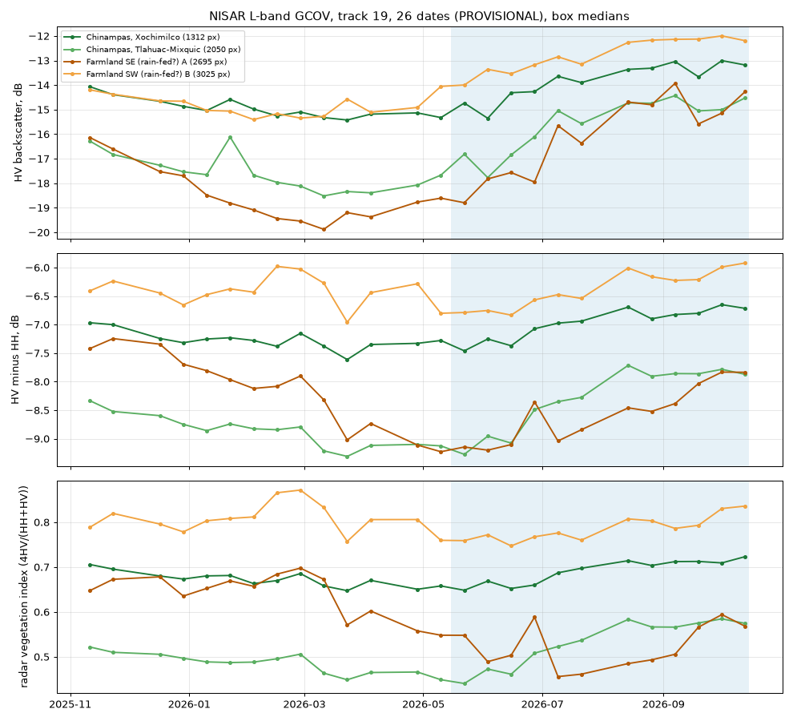

# Exploratory: chinampas vs rain-fed farmland, one year of NISAR backscatter

Status: Sun Nov 15, about 8:40 AM CT. **Exploratory and not for the app, the deck or the project page.** Drafted with AI assistance (Claude Code); see `docs/AI_USAGE.md`.

Question (Eduardo): can NISAR show a difference in crop activity between chinampas (Xochimilco, Tlahuac) and ordinary farmland across the year, including outside the normal growing season? This links to the challenge's crop-monitoring theme.



## Method

- Input: the 26 track 19 GCOV crops (`data/Mexico_City/`, Nov 11, 2025 to Oct 13, 2026, one every 12 days, one every 24 days around Aug 2). Dates Dec 5, 2025 and Apr 16, 2026 are left out (D-17). Oct 30, 2025 is not in this set (D-13). All PROVISIONAL.
- Four hand-drawn boxes (`fig_plot_locations.png`, drawn on EOX Sentinel-2 cloudless 2024): two chinampa areas (Xochimilco; Tlahuac to Mixquic) and two farmland areas (south-east, south-west). Per date: the median HV and HH backscatter (dB) over each box, HV minus HH, and the radar vegetation index 4HV/(HH+HV) from mean linear power.
- Blue band: roughly the rainy season (May 15 to Oct 15). This is our assumption and is not sourced.

## What the data shows

| Box | Pixels | HV mean (dB) | HV std over the year (dB) | HV range (dB) |
|---|---|---|---|---|
| Chinampas, Xochimilco | 1312 | -14.4 | 0.79 | 2.4 |
| Chinampas, Tlahuac to Mixquic | 2050 | -16.7 | 1.35 | 4.1 |
| Farmland SE | 2695 | -17.4 | 1.80 | 5.9 |
| Farmland SW | 3025 | -13.9 | 1.18 | 3.4 |

- The south-east farmland has the clearest single season: HV falls from -16 dB in November to about -20 dB in March, then climbs to about -14 dB after the rains start (a range of about 6 dB). This is the pattern expected of a field crop on rain.
- Both chinampa boxes vary less over the year (range 2.4 and 4.1 dB), and the Xochimilco box stays within about 2 dB all year.
- **No repeated cycles are visible in either chinampa box.** The curves are smooth, with no sign of several harvests per year.

## What this does and does not support

- Supported: in these boxes, chinampa backscatter changes less through the year than the south-east farmland, as you would expect if the plots stay wet and covered rather than going bare in the dry season. This is a hypothesis, not a finding.
- **Not supported: any claim about output, yield or the number of rotations.** A box median over 80 m pixels averages crops, canals, paths and buildings. Chinampa plots are only a few metres wide, so every pixel is a mix. A 6 to 8 week crop would also be mostly smoothed out by the mix.
- HV backscatter also responds to soil moisture, standing water and crop height, not just how green the crop is. L-band is less sensitive to leaf greenness than optical imagery. Do not call this a vegetation index in public text.
- The boxes were drawn by eye on one optical image. Land use inside them is not checked. The Xochimilco box includes an urban edge, and the south-west box includes forest. A proper version needs a land-use layer or field-verified polygons.
- "Rain-fed" is an assumption for the two farmland boxes; some of that land may be irrigated.
- No sourced number about chinampa rotations is in `docs/DECISION_MEMO.md`, so none is quoted here.

## To make it a real result

1. Verified polygons (a land-use or chinampa layer, ideally from SADER or the Xochimilco authority), eroded by one pixel to avoid edges.
2. Compare to optical NDVI from Sentinel-2 on the same dates, as an independent check.
3. Use many boxes per class and show the spread, not one median per box.
4. Cite a source for chinampa rotations and the local growing season.

## Run

```text
python poc/chinampas_vs_farmland/chinampas_poc.py --data data/Mexico_City --out poc/chinampas_vs_farmland
```

Needs numpy, pyproj, matplotlib, pillow, and internet access for the optical backdrop (it is written to `_optical.png`, which is not committed).

## Data credits

NISAR L2 GCOV PROVISIONAL (NASA/ISRO, ASF DAAC). Backdrop only: Sentinel-2 cloudless 2024 by EOX IT Services GmbH (contains modified Copernicus Sentinel data 2024), CC BY-NC-SA 4.0.
