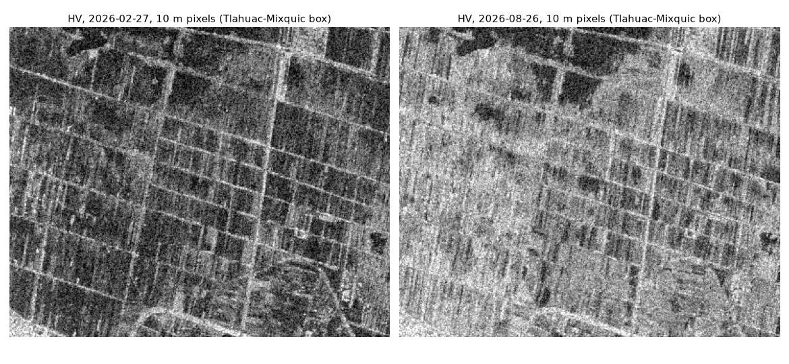
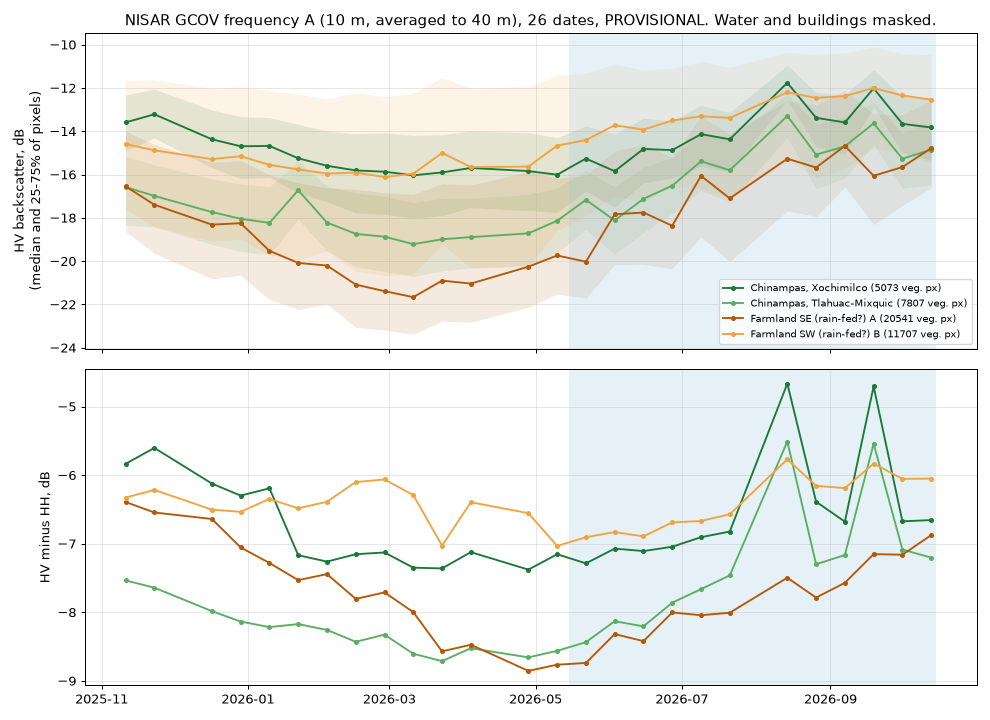
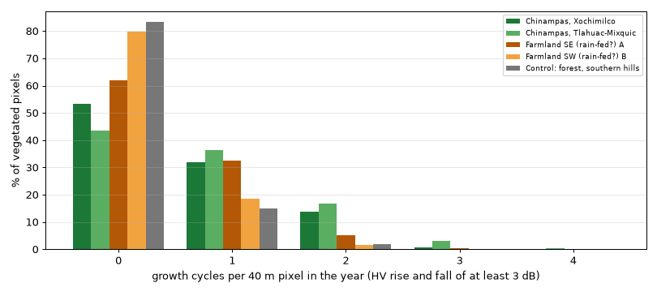
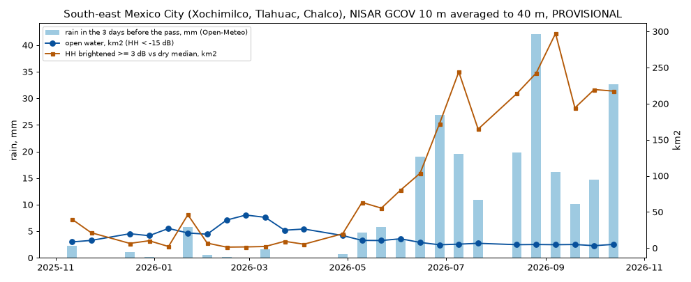
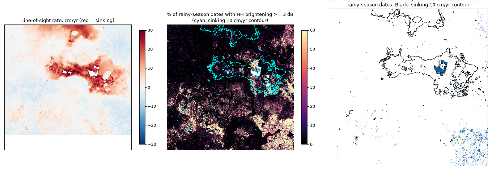

# Exploratory: chinampas vs rain-fed farmland, one year of NISAR backscatter

Status: Sun Nov 15, about 8:40 AM CT. **Exploratory and not for the app, the deck or the project page.** Drafted with AI assistance (Claude Code); see `docs/AI_USAGE.md`.

Question (Eduardo): can NISAR show a difference in crop activity between chinampas (Xochimilco, Tlahuac) and ordinary farmland across the year, including outside the normal growing season? This links to the challenge's crop-monitoring theme.


## Method

- Input: the 26 track 19 GCOV crops (`data/Mexico_City/`, Nov 11, 2025 to Oct 13, 2026, one every 12 days, one every 24 days around Aug 2). Dates Dec 5, 2025 and Apr 16, 2026 are left out (D-17). Oct 30, 2025 is not in this set (D-13). All PROVISIONAL.
- Four hand-drawn boxes (`fig_plot_locations.png`, drawn on EOX Sentinel-2 cloudless 2024): two chinampa areas (Xochimilco; Tlahuac to Mixquic) and two farmland areas (south-east, south-west). Per date: the median HV and HH backscatter (dB) over each box, HV minus HH, and the radar vegetation index 4HV/(HH+HV) from mean linear power.
- Blue band: roughly the rainy season (May 15 to Oct 15). This is our assumption and is not sourced.

## What the data shows

| Box | Pixels | HV mean (dB) | HV std over the year (dB) | HV range (dB) |
|---|---|---|---|---|
| Chinampas, Xochimilco | 1312 | -14.4 | 0.79 | 2.4 |
| Chinampas, Tlahuac to Mixquic | 2050 | -16.7 | 1.35 | 4.1 |
| Farmland SE | 2695 | -17.4 | 1.80 | 5.9 |
| Farmland SW | 3025 | -13.9 | 1.18 | 3.4 |

- The south-east farmland has the clearest single season: HV falls from -16 dB in November to about -20 dB in March, then climbs to about -14 dB after the rains start (a range of about 6 dB). This is the pattern expected of a field crop on rain.
- Both chinampa boxes vary less over the year (range 2.4 and 4.1 dB), and the Xochimilco box stays within about 2 dB all year.
- **No repeated cycles are visible in either chinampa box.** The curves are smooth, with no sign of several harvests per year.

## What this does and does not support

- Supported: in these boxes, chinampa backscatter changes less through the year than the south-east farmland, as you would expect if the plots stay wet and covered rather than going bare in the dry season. This is a hypothesis, not a finding.
- **Not supported: any claim about output, yield or the number of rotations.** A box median over 80 m pixels averages crops, canals, paths and buildings. Chinampa plots are only a few metres wide, so every pixel is a mix. A 6 to 8 week crop would also be mostly smoothed out by the mix.
- HV backscatter also responds to soil moisture, standing water and crop height, not just how green the crop is. L-band is less sensitive to leaf greenness than optical imagery. Do not call this a vegetation index in public text.
- The boxes were drawn by eye on one optical image. Land use inside them is not checked. The Xochimilco box includes an urban edge, and the south-west box includes forest. A proper version needs a land-use layer or field-verified polygons.
- "Rain-fed" is an assumption for the two farmland boxes; some of that land may be irrigated.
- No sourced number about chinampa rotations is in `docs/DECISION_MEMO.md`, so none is quoted here.

## To make it a real result

1. Verified polygons (a land-use or chinampa layer, ideally from SADER or the Xochimilco authority), eroded by one pixel to avoid edges.
2. Compare to optical NDVI from Sentinel-2 on the same dates, as an independent check.
3. Use many boxes per class and show the spread, not one median per box.
4. Cite a source for chinampa rotations and the local growing season.

## Update, Sun Nov 15, about 10:40 AM: full resolution (10 m)

Downloaded by windowed remote reads: NISAR GCOV **frequency A at 10 m** (HH, HV) for the same 26 dates and the same granules, over lon -99.23 to -98.87, lat 19.06 to 19.40. 26 crops, 3763 x 3788 pixels each, 2.0 GB, in `data/Mexico_City/gcov_freqA_chinampas/` (git-ignored). Scripts: `fetch_full_res_crops.py`, `chinampas_full_res.py`. Pixels are averaged 4 x 4 (40 m, 16 looks) for per-pixel statistics; water and buildings are masked with rough radar thresholds.



**What 10 m adds:** the chinampa plots and canals are visible individually (above: Tlahuac to Mixquic, Feb 27 against Aug 26, 2026). Single plots brighten in HV in the rainy season. At 80 m this was a blur.



**Growth cycles per pixel** (an HV rise and fall of at least 3 dB, about 3 times the noise at 16 looks), share of vegetated 40 m pixels with 2 or more cycles in the year:

| Box | All 26 dates | Without Aug 14 and Sep 19, 2026 |
|---|---|---|
| Chinampas, Xochimilco | 14.7% | 0.3% |
| Chinampas, Tlahuac to Mixquic | 20.1% | 6.3% |
| Farmland SE | 5.7% | 3.6% |
| Farmland SW | 1.9% | 1.3% |
| Control: forest, southern hills (noise floor) | 1.9% | 1.6% |



**Honest reading:**
- With all dates, chinampas look like they have more cycles than farmland. **That difference comes almost entirely from two dates, Aug 14 and Sep 19, 2026**, when HV minus HH jumps by 2 to 3 dB in both chinampa boxes for one acquisition and falls back. Without those two dates, Xochimilco shows no multi-cycle signal at all (0.3%, below the forest noise floor) and Tlahuac only a small excess (6.3% against 3.6% for farmland and 1.6% for forest).
- The two spikes are strongest in the wet, canal-laced chinampa zones and weaker elsewhere. Rain or flooding on those days, or a short-lived surface effect, would explain them better than harvests. We have not checked weather records, so this is not settled either way.
- So: **no robust evidence of more crop rotations in chinampas** from this data. The earlier 80 m finding (chinampas vary less through the year than the south-east farmland) still holds at 10 m for Xochimilco, but not clearly for Tlahuac.
- Everything in "What this does and does not support" above still applies. Resolution fixed the mixing problem; it did not fix the fact that HV responds to water as much as to crops. The next step is still an optical NDVI check on the same dates and verified plot polygons.

Not for the app, deck or project page.

## Update, Sun Nov 15, about 11:00 AM: rainy days, flooding and lake size

Question (Eduardo): use the rainy-season dates to see where water appears, whether it collects where the ground sinks, and how lake size changes between dry and rainy dates. Scripts: `flood_vs_sinking.py`, `lake_area.py`. Rain: Open-Meteo historical archive (reanalysis, about 10 km cells, not a rain gauge), summed over the 3 days before each 6:05 AM pass.




**Results (all PROVISIONAL, 40 m pixels):**

- **"Open water" (HH below -15 dB) is largest in the dry season, not the rainy one.** It peaks at 39 to 46 km2 in Feb and Mar and drops to 3 to 5 km2 from late June on. Dry, bare, smooth fields are as dark as water at L-band, and the threshold picks them up. In the rainy season, wet soil and growing crops turn bright. So a simple darkness threshold does not map floods here.
- **Brightening of 3 dB or more** (how flooded vegetation and soaked ground usually show at L-band) grows from about 2 km2 in Feb to 170 to 300 km2 from late June. It follows the rain, but it is mostly farmland in the south-east and south-west (crops and wet soil), not the sinking bowl.
- **Against the sinking rate** (line of sight; share of rainy-season dates with brightening): stable ground 12.7%, 2 to 10 cm/yr 8.9%, 10 to 20 cm/yr 7.6%, over 20 cm/yr 12.1%. New open water on rainy dates is tiny everywhere (0.07% on stable ground, 0.38% over 20 cm/yr). **No clear sign that water collects where the ground sinks fastest.**
- **Lakes:** new Lake Chalco (Lago de Tlahuac-Xico) reads about 4.3 to 5.0 km2 of dark water from Nov to Apr and about 2.8 to 3.9 km2 from May to Oct, about 20% smaller in the rainy season. The lake is very unlikely to really shrink in the rains. Wind and raindrops roughen the surface and floating plants spread in summer, and both make water look brighter to the radar. Xochimilco's open water is too small and too vegetated (0.0 to 0.45 km2, jumping between dates) to measure this way.
- The Aug 14 and Sep 19 spikes from the previous section are not the wettest dates (3-day rain 19.8 and 10.1 mm; Aug 26 had 42.1 mm and no spike). Rain alone does not explain them.

**Honest reading:** with backscatter brightness alone, this data cannot tell floods from wet soil, growing crops, wind on water and floating plants. The idea is sound but needs a better water detector, after the hackathon: a per-pixel dry-season reference with a change test, GUNW coherence (it drops sharply when water covers the ground), and dates matched to known floods (the 2024 Chalco flood is before NISAR's data). **Nothing here is for the app, deck or project page.**

## Run

```text
python poc/chinampas_vs_farmland/chinampas_poc.py --data data/Mexico_City --out poc/chinampas_vs_farmland
```

Needs numpy, pyproj, matplotlib, pillow, and internet access for the optical backdrop (it is written to `_optical.png`, which is not committed).

## Data credits

NISAR L2 GCOV PROVISIONAL (NASA/ISRO, ASF DAAC). Backdrop only: Sentinel-2 cloudless 2024 by EOX IT Services GmbH (contains modified Copernicus Sentinel data 2024), CC BY-NC-SA 4.0.
