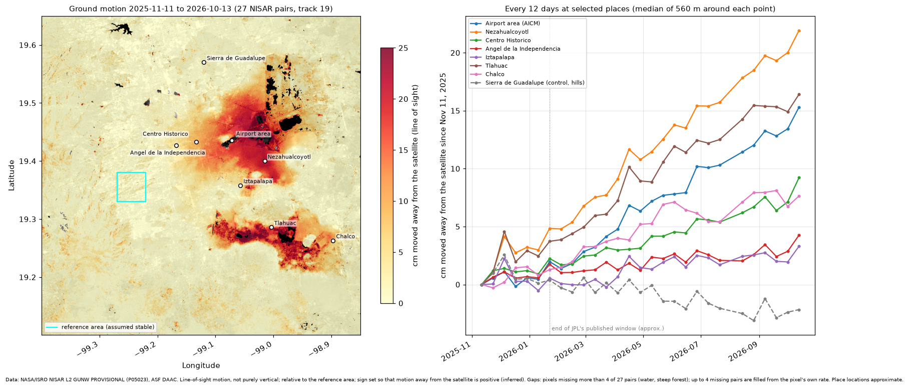

# Proof of concept: a year of Mexico City sinking, measured with NISAR

Status: Sat Nov 14, 11:35 PM CT. Runs on the 27 GUNW crops in `data/Mexico_City/` (or any folder given with `--data`). Takes under 10 seconds. Any pair touching Oct 30, 2025 is skipped (D-13).

Drafted with AI assistance (Claude Code). See `docs/AI_USAGE.md`.



## What it shows

Adding up 27 consecutive 12-day NISAR interferograms (track 19, Nov 11, 2025 to Oct 13, 2026, all PROVISIONAL) gives one year of ground motion. Two sinking bowls appear:

- **North-east**: the airport, Nezahualcoyotl and the old Texcoco lakebed.
- **South-east**: Tlahuac, Chalco and the Xochimilco lakebed.

The western hills and the Sierra de Guadalupe barely move. That matches where NASA JPL's April 2026 NISAR image puts the sinking ("Benito Juarez International Airport near the center of the mapped deformation field").

| Place (approximate location) | Moved away from the satellite, Nov 11 to Oct 13 | Per year | Per month |
|---|---|---|---|
| Nezahualcoyotl | 21.9 cm | 23.8 cm | 2.0 cm |
| Tlahuac | 16.4 cm | 17.8 cm | 1.5 cm |
| Airport area (AICM) | 15.3 cm | 16.6 cm | 1.4 cm |
| Centro Historico | 9.2 cm | 10.0 cm | 0.8 cm |
| Chalco | 7.6 cm | 8.3 cm | 0.7 cm |
| Angel de la Independencia | 4.3 cm | 4.6 cm | 0.4 cm |
| Iztapalapa | 3.3 cm | 3.6 cm | 0.3 cm |
| Sierra de Guadalupe (control, hills) | -2.2 cm | | |

Whole map:

- 1% of the valid area moves faster than **24 cm per year** along the line of sight.
- About **338 km2** moves faster than 10 cm per year, and about **105 km2** faster than 20 cm per year.
- In the first 72 days (Nov 11 to Jan 22, about JPL's published window) the fastest 0.1% of pixels moved about 10 cm, which is roughly 4 cm per month.

### How this compares with what was published

| Source | Says | Our number |
|---|---|---|
| NASA JPL, Apr 29, 2026 (NISAR, Oct 25, 2025 to Jan 17, 2026) | parts of the region subsiding "by more than half an inch (more than 2 centimeters) per month" | 2.0 cm per month at Nezahualcoyotl over the full year, about 4 cm per month at the fastest pixels in the first 72 days |
| AP coverage of the JPL release | "nearly 10 inches (about 25 centimeters) a year" | 24 cm per year at the 99th percentile |
| Chaussard et al. 2021, JGR Solid Earth | rates "reach 50 cm/year" (read the abstract before quoting) | below that, but ours is line of sight, not vertical |

Our numbers are **along the radar line of sight**. The radar looks at the ground from the side, so vertical sinking shows up smaller in this direction. Converting needs the incidence angle from the product metadata (not in our crops yet). So the vertical rates are likely somewhat higher than the table.

## Why the earlier attempt failed and this one works

1. **One shared zero.** Every pair has its own arbitrary offset. We subtract the median of the same western-hills area (cyan box) from all 27 pairs.
2. **No tilt removal on single pairs.** The bowls cover much of the box, so removing a fitted tilt from each pair absorbs the sinking itself.
3. **The ionosphere layer** is subtracted from each pair. Without it the far field drifts by a few cm.
4. **Unwrapping patches.** In the two pairs around Mar 23, 2026 the north of the box is a separate patch (connected component). It is re-attached by the whole number of 12.1 cm cycles that best matches the neighbouring pairs. The answer was 0 cycles.
5. **Gaps.** Some dates lose coherence in places: a strip on Mar 23, 2026, and the airport on Nov 23, 2025. Each such date knocks out the two pairs that share it. A pixel missing at most 4 of 27 pairs gets those increments filled from its own average rate.
   - 87% of pixels needed no filling, 12% were filled, and 1% (water, steep forest) are dropped.
   - The filled pixels are recorded in `filled_pairs` in the output file.
6. **Adding consecutive pairs cancels most atmospheric noise.** Each date's atmosphere enters once with a plus and once with a minus. That is why the curves zig-zag (for example around Dec 17) but do not drift.

## Honest limits

- PROVISIONAL data, CRID P05023.
- **The sign is inferred, not read from the specification.** The known sinking zones come out positive, so we call positive "away from the satellite". Confirm in the GUNW specification (JPL D-102272) before the app says "sinking" in words.
- The wavelength (24.2 cm) is taken from a GUNW of the same mode on another track, because the crops do not store it. The effect on the numbers is about 1 to 2%.
- The control point in the hills drifts by about -2 cm over the year. Treat about 2 cm as the uncertainty of any single number.
- The 80 m pixels are averages; individual buildings are not resolved. Place locations are approximate and must be checked on a map before any name goes into the app.
- A few isolated pixels show impossible rates (over 100 cm per year): unwrapping errors. Quote percentiles, never the maximum.

## Outputs

| File | What |
|---|---|
| `fig_mexico_city_year_of_sinking.png` | map and time series above |
| `landmark_series_los_cm.csv` | the eight places, one value per date (feeds `los_displacement_cm` in `landmarks.json`, see `docs/DATA_CONTRACT.md`) |
| `provenance.json` | units, sign (inferred), reference area, the 27 granule names, dates, wavelength, `MAX_FILLED`, and the whole-map numbers above. Its top-level keys are the `--los-metadata` format of PR #20 |
| `data/Mexico_City/los_total_cm.tif` (git-ignored) | year total, cm, line of sight, Nov 11, 2025 to Oct 13, 2026. EPSG:32614, 80 m, float32, NaN = no data |
| `data/Mexico_City/los_rate_cm_per_year.tif` (git-ignored) | per-pixel rate, cm per year (year total / 336 days). Same grid. This is the `--los` input of PR #20 |
| `data/Mexico_City/displacement_cumulative.npz` (git-ignored) | full stack: 28 dates x 761 x 723, cm, UTM 14N, plus `filled_pairs` |

The year total is what T-33 needs for the ground-motion layer; the stack gives monthly frames if time allows. The rate raster feeds the flood-priority map (T-34).

## Run

```text
python poc/mexico_city_sinking/sinking_poc.py                    # crops in data/Mexico_City/
python poc/mexico_city_sinking/sinking_poc.py --data path/to/crops
```

Needs numpy, pyproj, matplotlib, rasterio. The big outputs are written into the crops folder; the figure, CSV and `provenance.json` into this folder.

## Sources

- NASA JPL, "US-Indian Space Mission Maps Extreme Subsidence in Mexico City", Apr 29, 2026: <https://www.jpl.nasa.gov/news/us-indian-space-mission-maps-extreme-subsidence-in-mexico-city/>
- Chaussard, E., et al. (2021). Over a century of sinking in Mexico City. JGR Solid Earth, doi:10.1029/2020JB020648
- ASF, NISAR PROVISIONAL known issues: <https://nisar-docs.asf.alaska.edu/provisional-known-issues/>
